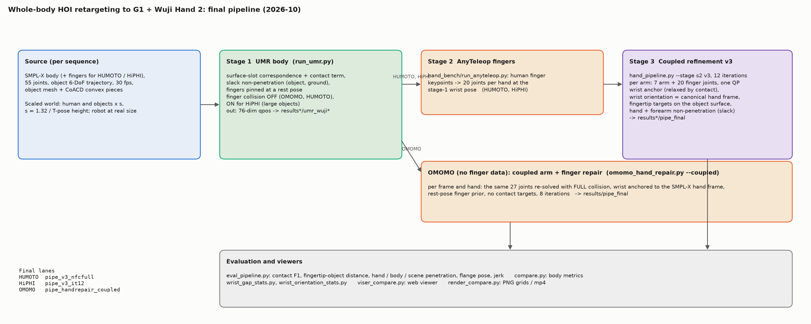
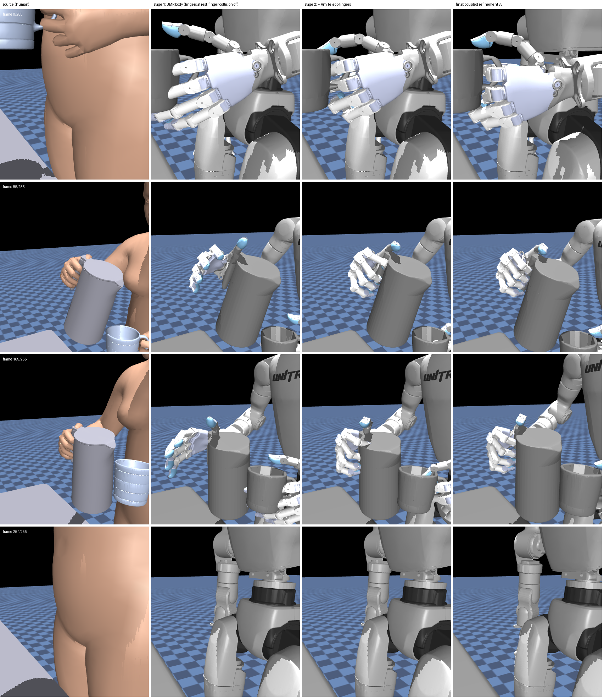

# Handover: whole-body human-object-interaction retargeting to G1 + Wuji Hand 2

Branch `handover-2026-10` of github.com/zkf1997/retarget (2026-10-20). Everything below lives in `omomo_bench/` unless
stated otherwise. This document is the entry point; `README.md`  has the
stage-by-stage details and the full ablation history; `RELEASE_FORMAT.md` the result archive format; `reports/` the
analysis reports; `hand_bench/README.md` the finger-retargeting bench.

## 0. Quick start

**Just look at the results (10 minutes, no submodules, no SMPL-X files, no GPU).**
```bash
git clone -b handover-2026-10 git@github.com:zkf1997/retarget.git && cd retarget
tar -xzf /path/to/retarget_final_results_<date>.tar.gz --strip-components=1 -C .   # adds omomo_bench/data*, results*/pipe_final, urdf/
bash omomo_bench/relocate.sh                                                           # only if the clone is not at /home/kaizhao/projects/retarget
conda activate hsretargeting                                                            # section 3; viewer needs mujoco, viser, yourdfpy, trimesh, scipy
cd omomo_bench && BENCH_DATASET=humoto python viser_compare.py --port 8090 --all-objects --lane final=results_humoto/pipe_final
```
Open http://localhost:8090 (ssh: `ssh -L 8090:localhost:8090 <machine>`). Same with `BENCH_DATASET=hiphi ... results_hiphi/pipe_final`
and `BENCH_DATASET=omomo ... results/pipe_final`. The human is drawn as joints unless SMPL-X files are present (section 3).
To read the npz files in your own code: `RELEASE_FORMAT.md`, section "Result npz" (a 12-line MuJoCo example).
Self-check of the whole setup (paths, data, final lanes, npz + MJCF, viewer, offscreen render): `bash omomo_bench/scripts/check_handover.sh` (prints `ALL CHECKS PASSED`).

**Reproduce a dataset end to end (hours):** section 4. **Understand why the pipeline looks like this:** the table below.

| question | where |
|---|---|
| what each stage does, with equations | `README.md` section 2 (2.1 body, 2.2 fingers, 2.3 coupled refinement) |
| why UMR and not OmniRetarget as body stage | `reports/umr_vs_omni_3ds.md`, `reports/body_stage_comparison_2026-10-17.md` sections 2, 7 |
| why finger collision is off in the body stage | `reports/umr_finger_collision_3ds.md`, `body_stage_comparison` sections 4–6 |
| why CoACD pieces and not the convex hull for OmniRetarget | `body_stage_comparison` section 3, README 6.9 |
| the "hand on the far side of the chair" defect | `reports/whitechair_002_wrong_side.md`, `reports/pushed_sequences_umr_wuji.md` |
| the OmniRetarget hand-bake bug (what was wrong before 2026-10-14) | section 9 here, `README.md` section 8, `reports/figures/omni_hand_bake_bug.png` |
| every other ablation (real-size objects, remapping, dense contact term, 12 iterations, multi-object) | `README.md` section 6 |

### Glossary

| term | meaning |
|---|---|
| **lane** | one result set, a directory of `<seq>.npz` (`results*/<lane>/`); the viewers show lanes side by side |
| **s**, scaled world | `smpl_scale = 1.32 / human T-pose height`; human and objects scaled by s, robot at real size (`RELEASE_FORMAT.md`, Conventions) |
| **body stage** / `umr_wuji`, `umr_wuji_nofingercol` | UMR run with fingers pinned at a rest pose; `nofingercol` = finger collision geoms off |
| **s2** / `pipe_s2*` | body stage + AnyTeleop finger joints substituted per frame |
| **v3** / `pipe_v3*` | coupled arm+finger refinement (section 1, step 4); `_it12` = 12 iterations, `_nfcfull` = on the nofingercol body, full set |
| **coupled repair** / `pipe_handrepair_coupled` | OMOMO's replacement for s2+v3 (no finger data): arm+finger re-solve with full collision |
| **pipe_final** | symlink (archive: directory) to the lane chosen as final for the dataset |
| **flange** | the hand mount frame, 4.15 cm distal of `wrist_yaw_link`; flange errors are measured against the human canonical hand frame |
| **canonical hand frame** | x wrist -> middle MCP, z pinky -> index MCP (orthogonalised), y = z x x; defined for human (SMPL-X joints) and robot alike |
| **pushed off** | body-stage defect: robot wrist > 12 cm from the human wrist while the human hand is on the object (`wrist_gap_stats.py`) |
| **OmniRetarget** / omni lanes | holosoma's interaction-mesh retargeter, body-stage comparison only (`omni_wuji_umrscale`, `_native` = convex hull) |

## 1. What this is

Three human-object-interaction datasets are retargeted to the Unitree G1 (29 DoF) with the Wuji Hand 2 (20 DoF per hand):

| dataset | sequences | human source | fingers in source | objects | final lane |
|---|---|---|---|---|---|
| OMOMO | 602 (15 objects, 2 subjects) | SMPL-X | no (flat hands) | one per sequence, large (chairs, tables, boxes, poles) | `results/pipe_final` = `pipe_handrepair_coupled` |
| HUMOTO | 100 (41 hand-held objects) | SMPL-X fitted from Mixamo (hiphi2smplx) | yes | hand-held object + furniture (multi-object) | `results_humoto/pipe_final` = `pipe_v3_nfcfull` |
| HiPHI | 60 (13 objects) | SMPL-X fitted per sequence (hiphi2smplx) | yes | one large object | `results_hiphi/pipe_final` = `pipe_v3_it12` |

Final pipeline (chosen after the ablations in README sections 5–6 and `reports/body_stage_comparison_2026-10-17.md`):

1. **Scaled world.** Human and objects are scaled by `s = 1.32 / T-pose height` (robot at real size). Objects use CoACD
   convex pieces for collision.
2. **Body stage: UMR** (`run_umr.py --hand wuji`), fingers pinned at a rest pose. For OMOMO and HUMOTO the 50 finger
   collision geoms are switched off (`--variant nofingercol`; palm and forearm still collide) because the rest-pose fingers
   are 34 % longer than the human's and otherwise push the hand to the far side of thin rails / rims; HiPHI keeps full
   collision (large objects, see section 9).
3. **Finger stage (HUMOTO, HiPHI): AnyTeleop** (`../hand_bench/run_anyteleop.py --hand wuji`), fingers from the human
   finger keypoints at the body-stage wrist pose.
4. **Coupled refinement v3** (`hand_pipeline.py --stage s2 v3 --v3-iters 12 [--multi]`): per arm a 27-DoF QP (7 arm + 20
   finger joints) with a wrist anchor relaxed by contact, wrist orientation to the human canonical hand frame, fingertip
   contact targets on the nearest object surface (thumb / index first), correction-space arm smoothing, slack
   non-penetration of hand and forearm against every object, joint limits (Clarabel).
5. **OMOMO without finger data:** instead of 3–4, `omomo_hand_repair.py --coupled`: per frame and hand the 27 joints are
   re-solved with full collision, wrist anchored to the SMPL-X hand frame, rest-pose finger prior, no contact targets.
6. **Evaluation** `eval_pipeline.py` (hand + body metrics) / `compare.py` (body-stage metrics), viewers `viser_compare.py`,
   `render_compare.py`.




*One HUMOTO sequence through the stages (right-hand close-up, `render_compare.py --focus right_hand`): source | UMR body with rest-pose fingers | + AnyTeleop fingers | final after coupled refinement.*

Data flow (one dataset; `*` = `""`, `_humoto` or `_hiphi`):
```
raw dataset ──prepare_*.py──▶ data*/source/<seq>.npz, data*/objects/<obj>/, data*/umr/, data*/omni/
      │
      ├─ run_umr.py --hand wuji [--variant nofingercol] ───▶ results*/umr_wuji[_nofingercol]/<seq>.npz      (body stage)
      │
      ├─ hand_bench/run_anyteleop.py --hand wuji ─────────▶ hand_bench/results*/anyteleop/wuji/<seq>__<side>.npz   (HUMOTO, HiPHI)
      │
      ├─ hand_pipeline.py --stage s2 v3 --body-lane ... ──▶ results*/pipe_s2*/, results*/pipe_v3*/  ──▶ results*/pipe_final  (HUMOTO, HiPHI)
      ├─ omomo_hand_repair.py --coupled --body-lane ... ──▶ results/pipe_handrepair_coupled/        ──▶ results/pipe_final   (OMOMO)
      │
      └─ eval_pipeline.py / compare.py / wrist_*_stats.py ─▶ results*/pipe_metrics*.csv, pipe_summary*.md, summary*.md, wrist_*.csv
viser_compare.py / render_compare.py read data*/source + data*/objects + any lane.
```

Final numbers (full collision model, same CoACD geometry for every lane; metric definitions in section 5):

| metric (mean over sequences) | definition | HUMOTO | HiPHI | OMOMO |
|---|---|---|---|---|
| fingertip contact F1 | per frame and fingertip, "in contact" = tip within 2 cm (`--tau`) of the object surface; F1 of robot contacts against human contacts, over interaction frames (a human fingertip within 3 cm of the object) | 0.799 | 0.577 | – (no finger data) |
| hand-object penetration (mm) / frames > 5 mm | deepest penetration of any hand collision geom into the object (CoACD pieces) per frame, mean over interaction frames; fraction of those frames deeper than 5 mm | 0.89 / 4.6 % | 0.66 / 1.6 % | 1.23 / 6 % |
| flange position (cm) / rotation (deg) | robot flange (`{l,r}_mount`) vs the human wrist keypoint, in human units (robot world / s); rotation = geodesic angle between the robot `wrist_yaw` frame and the human canonical hand frame | 2.42 / 4.0 | 3.04 / 6.0 | wrist 2.26 cm |
| hand pushed across the object (sequences) | sequences where a hand is > 12 cm from the human wrist in > 50 % of the frames the human hand is on the object (`wrist_gap_stats.py` on the final lane: `results*/wrist_gap_final.log`, OMOMO `wrist_gap_omomo_coupled.log`) | 0 | 1 | 5 |
| joint jerk / root jerk | mean absolute third finite difference of the 29 body joint angles / of the root position, divided by dt^3 at 30 fps (rad s^-3, m s^-3) | 167 / 16 | 134 / 10 | 189 / 10 |

Body-stage comparison with OmniRetarget (holosoma) on all three datasets: `reports/umr_vs_omni_3ds.md`,
`reports/body_stage_comparison_2026-10-17.md`. Short version: OmniRetarget tracks the wrist position better and keeps
contact, UMR has 3–4x better wrist orientation, never fails, near-zero ground penetration, 3–4x lower root jerk and is
10–20x faster; the hand stages re-solve the arms anyway, so UMR is the body stage.

## 2. Repository layout (the parts that matter)

```
retarget/
├── UMR/                      submodule: UMR retargeting (body stage).  Patch: omomo_bench/patches/umr_multi_object_retarget_prop.patch
├── holosoma/                 submodule: OmniRetarget (holosoma_retargeting) — comparison only
├── urdf/g1_wuji_hand2/       G1 + Wuji Hand 2 URDF + meshes (also g1_brainco_revo2/)
├── hand_bench/               finger retargeting (AnyTeleop / TopoRetarget), human hand keypoints, hand models   [env handbench]
└── omomo_bench/
    ├── prepare_omomo.py / prepare_humoto.py / prepare_hiphi.py / prepare_humoto_multi.py   dataset -> data*/ (source npz, objects, UMR/holosoma inputs)
    ├── run_umr.py              body stage (UMR)                                 [env umr]
    ├── hand_pipeline.py        stages s2 (AnyTeleop fingers) and v3 (coupled refinement)   [env umr]
    ├── omomo_hand_repair.py    OMOMO coupled arm+finger repair                  [env umr]
    ├── eval_pipeline.py        hand + body metrics -> results*/pipe_metrics*.csv, pipe_summary*.md   [env umr]
    ├── compare.py              body-stage metrics, model builders (augmented_model, umr_object_pos, ...)   [env umr | hsretargeting]
    ├── wrist_gap_stats.py / wrist_orientation_stats.py   "hand pushed off" and wrist-orientation statistics
    ├── run_omni.py / omni_entry.py   OmniRetarget runner (hand baking, fallback chain, upstream patches)   [env hsretargeting]
    ├── viser_compare.py        interactive side-by-side viewer (source human + any number of result lanes)   [env hsretargeting]
    ├── render_compare.py       PNG grids / mp4 side-by-side renders (MuJoCo EGL)   [env hsretargeting | umr]
    ├── run_final_pipeline.sh   one command per dataset: body -> hand stages -> metrics -> results*/pipe_final
    ├── run_variant_pipeline.sh, run_nfc_full.sh, run_dense_chain.sh   ablation chains
    ├── scripts/                drivers of the 2026-10 reruns (OmniRetarget rebake, 3-dataset comparisons, finger-collision study)
    ├── reports/                analysis reports (md) + key figures
    ├── configs/umr_g1_wuji*.json   UMR robot configs (base + variants: nofingercol, free, flat, v2, contact0/4, multi, real)
    ├── robots/g1_29dof_wuji_hand2*.xml   MJCF of the hand-equipped G1 (make_hand_mjcf.py)
    ├── pack_release.py, RELEASE_FORMAT.md   result archive
    ├── relocate.sh             rewrite absolute paths after cloning elsewhere
    ├── data[_humoto|_hiphi]/   (git-ignored) converted inputs       -> in the archive
    ├── results[_humoto|_hiphi]/ (git-ignored) result lanes, logs, metrics, figures   -> pipe_final in the archive
    └── omni_workdir[_humoto|_hiphi]/ (git-ignored) holosoma work dirs
```

## 3. Environments

Clone with submodules: `git clone --recursive -b handover-2026-10 git@github.com:zkf1997/retarget.git` (or `git submodule update --init UMR holosoma`
in an existing clone). The viewers and the result archive do not need the submodules; the `umr`-env scripts (body stage, hand
stages, metrics) import UMR, `run_omni.py` needs holosoma. `omomo_bench/wbt/` and `spider_bridge/` (policy training, SPIDER
bridge) are separate work and out of scope here.

Three conda environments (`env_setup.sh` creates `umr` and `hsretargeting`; `hand_bench/README.md` has `handbench`):

| env | python | used by | key packages |
|---|---|---|---|
| `umr` | 3.12 | UMR, `hand_pipeline.py`, `omomo_hand_repair.py`, `eval_pipeline.py`, `run_umr.py` | torch 2.4.1 cu121, mujoco 3.3.7, clarabel 0.11, trimesh 5.1, `UMR/requirements-umr.txt` |
| `hsretargeting` | 3.11 | holosoma / `run_omni.py`, `viser_compare.py`, `render_compare.py`, `compare.py` | **mujoco pinned 3.3.5** (>= 3.14 silently breaks holosoma), viser 1.1.1, yourdfpy, trimesh, smplx, torch, fast_simplification, imageio |
| `handbench` | 3.11 | `hand_bench/run_anyteleop.py` | mujoco 3.3.5, dex-retargeting 0.5.0, trimesh, viser |

Scripts call the interpreters by absolute path (`/home/kaizhao/software/miniconda3/envs/<env>/bin/python`) or via
`UMR_PYTHON` / `HS_PYTHON`. SMPL-X body models (license-gated) go to `UMR/smpl/SMPLX_{MALE,FEMALE,NEUTRAL}.npz` or
`$SMPLX_DIR/smplx/`; the viewer works without them (joints only).

After cloning to another path: `bash omomo_bench/relocate.sh` (rewrites `/home/kaizhao/projects/retarget` in the MJCFs,
configs and scripts; set `CONDA_ROOT` if conda lives elsewhere). Paths that stay machine-specific and must be edited by hand
if you re-run those steps: raw dataset roots in `prepare_omomo.py`, `prepare_hiphi.py`, `hand_bench/humoto_io.py`,
`hand_bench/hiphi_io.py`; the SMPL-X source in `env_setup.sh`; the SMPL-X default in the viewers (`SMPLX_DIR`). Then `git -C UMR apply omomo_bench/patches/umr_multi_object_retarget_prop.patch`
(needed for `--scaling realhand|multi` only) and `git apply` of `patches/hiphi2smplx_mixamo_hands_hoi.patch` in a clone of
github.com/noitom-robotics/hiphi2smplx@65e5131 if you need to re-fit HUMOTO / HiPHI.

## 4. Reproducing the final results

Inputs (`data*/`) are produced by the `prepare_*.py` scripts from the raw datasets (paths inside the scripts; README
section 7) and are included in the result archive. AnyTeleop finger results (`hand_bench/results*/anyteleop/wuji/`) must
exist before the HUMOTO / HiPHI hand stages:

```bash
cd hand_bench && conda activate handbench && export MUJOCO_GL=disable
BENCH_DATASET=humoto python run_anyteleop.py --hand wuji --workers 16      # HUMOTO
BENCH_DATASET=hiphi  python run_anyteleop.py --hand wuji --workers 16      # HiPHI
```

Then one command per dataset (runs the body stage, the hand stages and the metrics, links `results*/pipe_final`):

```bash
cd omomo_bench
bash run_final_pipeline.sh humoto 3                    # body variant nofingercol, multi-object v3, 12 iterations
bash run_final_pipeline.sh hiphi 3 --no-slot-reuse     # default body (per-sequence SMPL-X shapes need --no-slot-reuse)
bash run_final_pipeline.sh omomo 3                     # body nofingercol -> omomo_hand_repair.py --coupled
```

`BODY_VARIANT=` (empty) or `=nofingercol` overrides the body variant. The script names its hand-stage lanes
`pipe_v3_final_multi` (HUMOTO), `pipe_v3_final_it12` (HiPHI), `pipe_handrepair_coupled` (OMOMO) and links `results*/pipe_final`
to them; the archived lanes `pipe_v3_nfcfull` / `pipe_v3_it12` are the same configuration produced by earlier runs with other
`--out-suffix` values. Individual steps, if needed:

```bash
BENCH_DATASET=humoto python run_umr.py --hand wuji --variant nofingercol --workers 3          # -> results_humoto/umr_wuji_nofingercol
BENCH_DATASET=humoto python hand_pipeline.py --stage s2 v3 --v3-iters 12 --multi --body-lane umr_wuji_nofingercol --out-suffix _nfcfull --workers 8
BENCH_DATASET=humoto python eval_pipeline.py --workers 8 --out _nfcfull --lane body=results_humoto/umr_wuji_nofingercol --lane final=results_humoto/pipe_v3_nfcfull --multi
BENCH_DATASET=omomo  python omomo_hand_repair.py --coupled --iters 8 --body-lane umr_wuji_nofingercol --out pipe_handrepair_coupled --workers 8
```

Long runs go in tmux (session `real_runs` on the original machine); both runners skip sequences whose npz exists, so a
re-run resumes. Timings on 24 cores: UMR body 0.1–0.25 s/frame, AnyTeleop minutes per dataset, v3 12 iterations ~3.5 h per
100 sequences, OMOMO coupled repair ~6 s/sequence, `compare.py` single-process ~2.5 h for 602 x 4 lanes (chunk with
`--seqs` + `--out _partN`, then `--merge ... --lane ...`).

## 5. Evaluation

- `eval_pipeline.py --out <suffix> --lane name=dir[:suffix] ... [--multi]`: fingertip contact F1 / recall / precision
  (human fingertip within 2 cm of the object <-> robot fingertip within 2 cm), fingertip-object distance error, hand and
  whole-body object penetration, scene penetration (all objects), flange position / rotation error vs the human canonical
  hand frame, joint / root / finger jerk, knuckle+palm contact (`kp_*`). Always pass `--out`; without it the default
  `pipe_metrics.csv` is overwritten.
- `compare.py --lane ...`: body-stage metrics (object / ground penetration, foot slide, hand-contact preservation, wrist /
  ankle error, jerk, runtime, OmniRetarget fallback counts). `--merge` needs the same `--lane` list, otherwise lanes are dropped.
- `wrist_gap_stats.py --lane ...`: frames where the human wrist is within 10 cm of the object and the robot wrist is more
  than 12 cm from the (scaled) human wrist; a hand is "pushed off" in a sequence when that holds for > 50 % of its contact frames.
- `wrist_orientation_stats.py --lane ...`: wrist orientation error vs the human canonical hand frame (x wrist -> middle MCP,
  z pinky -> index MCP, y = z x x), per side, interacting vs free frames.

## 6. Visualisation

`viser_compare.py` (env `hsretargeting`) serves an interactive web page: source human (SMPL-X mesh, decimated to 4 000
faces for bandwidth, or joints) + object(s) in lane 0, then one lane per result (robot from the URDF, MuJoCo FK, object at
the lane's scale). GUI: sequence dropdown, play / speed / frame, lane visibility, lane spacing (0 = all at the origin),
"source in robot world" (scale the human by `s`). Lanes are `--lane name=dir[:suffix]` (suffix `_original` for
OmniRetarget outputs); presets `--final` (`umr_wuji | pipe_s2 | pipe_final`) and `--pipeline` (all stages).

```bash
cd omomo_bench && conda activate hsretargeting
BENCH_DATASET=humoto python viser_compare.py --port 8090 --all-objects --lane 1_umr_body=results_humoto/umr_wuji_nofingercol --lane 2_anyteleop_fingers=results_humoto/pipe_s2_nfcfull --lane final=results_humoto/pipe_final
BENCH_DATASET=hiphi  python viser_compare.py --port 8091 --final
BENCH_DATASET=omomo  python viser_compare.py --port 8092 --seqs sub16_whitechair_002 --lane 1_umr_body=results/umr_wuji_nofingercol --lane final=results/pipe_final --lane ref_OmniRetarget=results/omni_wuji_umrscale:_original
```

The result archive ships only `results*/pipe_final`; with it, use `--lane final=results*/pipe_final` (the other lane names
above are intermediate lanes of the original machine; the viewer prints `lane ... skipped` and continues when a lane directory
is missing, and exits when none is left).

Ports used on the original machine: 8090 / 8091 / 8092 final pipelines (HUMOTO / HiPHI / OMOMO), 8094 HUMOTO multi-object
body comparison, 8095 white-chair analysis (5 sequences, 5 lanes), 8096–8098 "pushed-off" sequences per dataset. Each is
a `while true` loop in tmux `real_runs` (window `viser<port>`); killing the python process restarts it with the current
code. Over an ssh tunnel keep the lane count small or untick "source human" if playback stalls; the server log prints a
heartbeat every 10 s (`[viser] heartbeat t=.. renders/10s=.. clients=..`).

`render_compare.py` (MuJoCo EGL, env `hsretargeting`; mp4 needs the `umr` env's imageio-ffmpeg) writes PNG grids
(rows = frames, columns = source + lanes) or `--video` mp4s, with `--focus left_hand|right_hand --distance 0.6` for hand
close-ups, `--pipeline` for the stage columns, `--all-objects` for HUMOTO furniture.

## 7. Result archive

`python pack_release.py` copies, per dataset, `seqs_test.json`, `multi_objects*.json`, `source/*.npz`, `objects/`, the final
lane as `results*/pipe_final/` and its metrics, plus `urdf/g1_wuji_hand2`, into `../retarget_final_results_<date>/` and
tars it (~0.4 GB); `manifest.json` records the commit the archive was packed from. `RELEASE_FORMAT.md` (copied into the archive as `RESULTS_README.md`) documents every file and key. Extract
the archive over a clone of this branch (`tar -xzf <archive> --strip-components=1 -C <clone>`), run `relocate.sh`, and the
`--lane final=...` viewer / render commands work without the SMPL-X files (human shown as joints). `scripts/check_handover.sh`
verifies all of this in one go.

## 8. Reports and figures (`reports/`)

| file | content |
|---|---|
| `body_stage_comparison_2026-10-17.md` | summary of all body-stage comparisons: UMR vs OmniRetarget, CoACD vs hull, pushed-off mechanism, finger collision on/off, final-stage penetration, recommendations |
| `umr_vs_omni_3ds.md` | UMR vs OmniRetarget on the three datasets after the hand-bake fix (English tables) |
| `umr_finger_collision_3ds.md` | UMR body stage with / without finger collision, three datasets |
| `pushed_sequences_umr_wuji.md` | list of sequences where the body stage pushes a hand across the object |
| `whitechair_002_wrong_side.md` | geometric analysis of the defect on one OMOMO sequence |
| `figures/omni_hand_bake_bug.png` | what the OmniRetarget hand looked like before the bake fix |
| `figures/sub16_whitechair_002_analysis.png`, `figures/scaling_conflict.png` | analysis plots |
| `figures/pipeline_overview.png`, `figures/*_stages.png` | pipeline block diagram (`scripts/pipeline_figure.py`) and a stage-by-stage render of one HUMOTO sequence |

Full-size figures and videos (`sub16_whitechair_002_report_{right,left}.{png,mp4}`, `sub16_whitechair_002_approach_right.png`, `sub17_woodchair_000_native.png`, ...)
are in `results/figures/` on the original machine (git-ignored).

## 9. Known issues and pitfalls

Symptom -> cause -> fix:

| symptom | cause | fix |
|---|---|---|
| viewer prints `lane '...' skipped: ... does not exist` | lane not present (the archive ships only `pipe_final`) | pass `--lane final=results*/pipe_final` |
| viewer / renderer prints `SMPL-X unavailable ... showing joints` | license-gated SMPL-X files not installed | put `SMPLX_*.npz` in `UMR/smpl/` or set `SMPLX_DIR`; joints view is otherwise complete |
| viewer page loads but does not animate, or lags seconds behind | browser cannot keep up (ssh tunnel, many lanes); the server log still shows `heartbeat ... renders/10s=300` | untick "source human", show fewer lanes, lower speed |
| `FileNotFoundError ... /home/kaizhao/...` | absolute paths of the original machine | `bash omomo_bench/relocate.sh`; for raw-dataset roots edit the `prepare_*.py` constants |
| `ModuleNotFoundError: umr` / holosoma import errors | submodules not initialised | `git submodule update --init UMR holosoma` |
| holosoma run: all 29 joints stay at 0, only the root moves | mujoco >= 3.14 in `hsretargeting` | `pip install mujoco==3.3.5` |
| `compare.py --merge` summary lacks lanes | `--merge` without the `--lane` list | repeat the same `--lane` arguments |
| `eval_pipeline.py` overwrote `pipe_metrics.csv` | no `--out` | always pass `--out <suffix>` |
| UMR on HiPHI: slot / shape mismatch error | per-sequence SMPL-X shapes | `run_umr.py --no-slot-reuse` |
| OmniRetarget hand looks exploded in old figures / `*_oldbake` lanes | hand-bake bug fixed 2026-10-14 | use the rerun lanes; `run_omni.py --setup` regenerates models without `BAKE_MARK` |
| shell dies (exit 144) when killing a job | `pkill -f` / `pgrep -f` matched the shell's own command line | kill by PID |

Background on each:


- **OmniRetarget hand bake (fixed 2026-10-14).** `run_omni.py bake_hands` wrote compiled geom poses (which include
  MuJoCo's mesh re-centring) back into XML, so the raw STL was re-centred twice: every hand piece 1–4 cm off, rotated up
  to 171 deg. Fixed (reference-frame compensation, `BAKE_MARK` in generated models, `--setup` regenerates unmarked ones);
  every OmniRetarget lane was rerun; `results*/*_oldbake` hold the old ones. UMR lanes and all final results never used
  baked models.
- Rest-pose fingers in the body stage push the hand to the far side of thin rails / rims (UMR 57 / 11 / 4 sequences on
  OMOMO / HUMOTO / HiPHI counted per sequence; 62 / 16 / 5 when counted per hand, as `wrist_gap_stats.py` prints). Finger collision off removes it; the lane is only valid before a hand stage (finger penetration
  8–17 mm there). On HiPHI's large objects it costs 0.15–0.3 mm final penetration, hence the default stays on there.
  A per-sequence automatic rule (run both body variants; use fingers-off unless the full-collision body was not pushed and
  the fingers-off body penetrates > 20 mm) matches the better choice on both datasets but is not implemented yet.
- `compare.py --merge` without `--lane` drops lanes; `eval_pipeline.py` without `--out` overwrites `pipe_metrics.csv`.
- HiPHI: per-sequence SMPL-X shapes -> `run_umr.py --no-slot-reuse`; OmniRetarget uses `data_hiphi/seqs_test_perseq.json`.
- Never `pkill -f` / `pgrep -f` a pattern that appears in your own shell command (kills the shell); kill by PID.
- UMR npz `robot_xml` paths are per-sequence temp files overwritten by other runs; every script rebuilds the model from the
  `hand` key. Never load the 36-dof body qpos into the 76-qpos MJCF by index (joint order differs); map by name.
- mujoco >= 3.14 breaks holosoma (joints stay at 0); `hsretargeting` pins 3.3.5. The `umr` env uses 3.3.7 (fine for UMR).
- `trimesh.proximity` on 90k-face meshes needs the KD-tree prefilter in `compare.on_surface_chunked` (memory).
- The viewer's and renderer's SMPL-X path defaults to the original machine; set `SMPLX_DIR` or symlink into `UMR/smpl/`;
  without the files both show the source human as joints.
- Older `summary*.md` files are titled "OmniRetarget vs UMR on OMOMO" whatever the dataset and lanes (the title is now
  generated from the lanes).

## 10. Open items

1. Implement the automatic finger-collision rule (section 9) in `run_final_pipeline.sh`; optionally per hand
   (left / right `nofingercol` MJCF variants).
2. HiPHI: decide between smoothness (fingers off: joint jerk −16 %) and penetration (+0.15 mm); more v3 iterations or a
   higher non-penetration weight on large objects would remove the residual.
3. Root cause of the push-off is the placeholder finger geometry; scaling the body-stage finger collision geometry to the
   human hand length (or excluding finger-object pairs per frame when they are the only blocker, like OmniRetarget's
   fallback) would fix it in the body stage itself.
4. "OmniRetarget body + AnyTeleop + v3" was never run end-to-end; the recommendation for UMR as stage 1 rests on the
   body-stage metrics the later stages cannot repair (root jerk, ground / body penetration, fallback instability).
5. The OmniRetarget Mixamo-direct variant on HUMOTO (`results_humoto/omni_brainco_mx*`) predates the bake fix.
